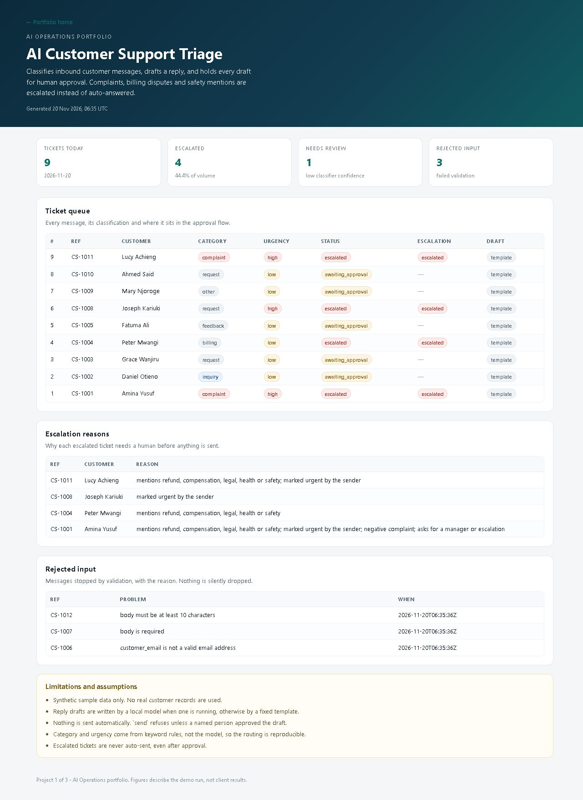

# Project 1 — AI customer support triage

A working triage pipeline for inbound customer messages. It classifies each
message, decides whether a human must handle it, writes a reply draft, and
holds every draft until a named person approves it.

This is a **portfolio project built with synthetic data**. It is not a
delivered client system and the numbers below describe the demo run only.

## The business problem

A small distributor answers the same handful of questions all day: delivery
days, price lists, damaged stock, invoice disputes. Two things go wrong:

1. Routine questions wait behind urgent ones because nobody has triaged them.
2. Complaints about damaged or unsafe stock get answered by whoever is free,
   with no escalation rule and no record.

## What this project does

| Step | Behaviour |
|---|---|
| Receive | Reads a JSONL inbox, one message per line |
| Validate | Rejects a bad email, an empty body or a body under 10 characters, and records why |
| Classify | Rules assign a category (complaint, billing, request, feedback, inquiry, other) |
| Score urgency | Urgency words raise it to high; complaints default to medium |
| Decide escalation | Refunds, legal wording, health and safety, urgency, or a request for a manager |
| Draft | The local model writes the reply; a fixed template is used when no model is running |
| Hold | Nothing is sent. Status is `awaiting_approval` or `escalated` |
| Approve | A named person approves; the approval is written to the event log |
| Send | Refused unless approved. Escalated tickets can never be auto-sent |
| Report | Daily counts by category and status, escalation rate, review queue |

## Run it

```bash
cd PROJECT-01-CUSTOMER-SUPPORT
python run.py demo          # reset and process data/inbox.jsonl
python run.py list
python run.py approve 2 --by "Your Name"
python run.py send 2
python run.py report
python run.py dashboard     # writes dashboard.html
```

No packages to install. Python 3.10 or newer.

## Demo result

From `data/inbox.jsonl`, 12 messages:

```
accepted 9 | rejected 3 | escalated 4 | needs review 1
escalation rate 44.4%
```

The three rejections are deliberate: one invalid email, one empty body, one
body under the minimum length. One message is deliberately vague and is
flagged for review rather than guessed at.



## Design decisions

**Rules route, the model writes.** Category, urgency and escalation are
keyword rules. That means the same input always produces the same routing, a
reviewer can read why a ticket was escalated, and the workflow still works
with no model running. The model is only used for the reply text, where
variety is an advantage.

**The approval gate is enforced in code, not in a document.** `send()` raises
`PermissionError` if the draft has no approver. There is a test for it.

**Escalation beats approval.** An escalated ticket cannot be sent even after
approval, because the person approving may not be the person qualified to
answer a safety complaint.

**Rejections are recorded, not dropped.** A message that fails validation is
written to a `rejected` table with the reason. Silent data loss is the most
common failure in support automation.

## Limitations

- Keyword rules misread unusual phrasing. "Latest price" can trip the
  `late` complaint rule. A production system would review mismatches weekly.
- The model is not asked to classify, so a genuinely ambiguous message is
  flagged rather than resolved.
- Sending writes a `.txt` file to `outbox/`. No mailbox is connected.
- There is no deduplication on customer plus subject, only on the message
  reference.
- The dashboard is generated, not live. Re-run `run.py dashboard` to refresh.

## Files

| File | Purpose |
|---|---|
| `support.py` | Pipeline: validation, classification, escalation, drafting, approval |
| `run.py` | Command line interface and dashboard |
| `schema.sql` | SQLite tables |
| `data/inbox.jsonl` | Synthetic sample messages |
| `make-scenario.json` | Make build spec (not an imported blueprint) |
| `make-logic.js` | Reference rules, executed by `tools/check_scenarios.py` |
| `architecture.md` | Flow diagram and node responsibilities |
| `test-cases.md` | Test evidence |
