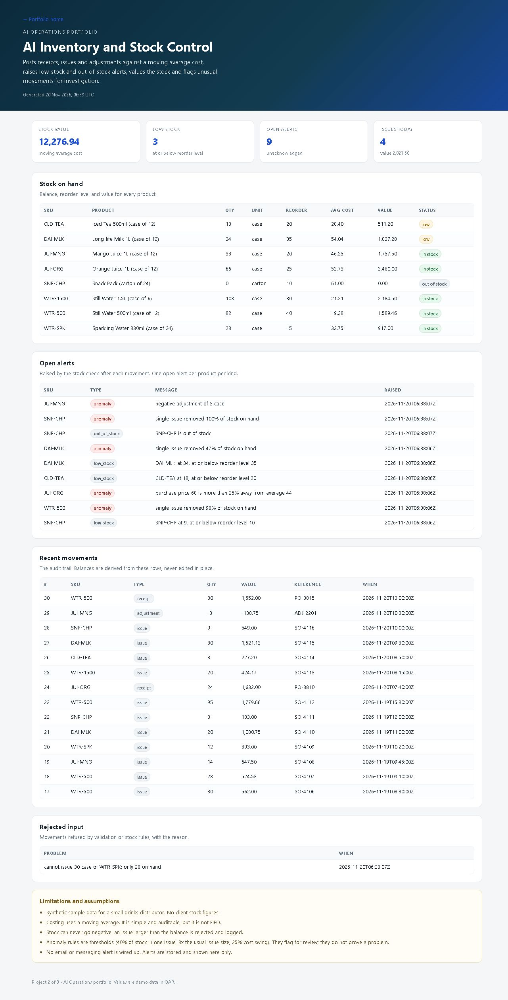

# Project 2 — AI inventory management

A stock control system that records every movement, keeps a running balance at
moving average cost, raises low-stock and out-of-stock alerts, values the
stock, and flags unusual movements for a person to look at.

Built with **synthetic data for a small drinks distributor**. It is a portfolio
project, not a delivered client system.

## The business problem

Small distributors lose money in three places:

1. **Overselling.** An order is taken for stock that has already gone, and the
   shortfall is discovered at the loading bay.
2. **Silent stockouts.** Nobody notices a line has dropped below its reorder
   level until a customer asks for it.
3. **Unexplained shrinkage.** Stock disappears and the records are edited in
   place, so the cause can never be found afterwards.

## What this project does

| Step | Behaviour |
|---|---|
| Record receipt | Increases stock and recalculates the moving average cost |
| Record issue | Decreases stock at the current average cost; refused if it exceeds the balance |
| Record adjustment | Signed correction with a reason; refused if it would make stock negative |
| Balance | Derived from the movement history, never edited directly |
| Low stock | Alert raised when the balance reaches the reorder level |
| Stockout | Alert raised at zero; a later recovery closes the open alert |
| Valuation | Quantity times moving average cost, per product and in total |
| Anomaly | One issue taking 40%+ of stock, 3x the usual issue size, or a 25% cost swing |
| Reports | Daily receipts, issues, adjustments, stock value, alert count |
| Reject | Unknown SKU, oversell, zero quantity, duplicate reference, negative result |

## Run it

```bash
cd PROJECT-02-INVENTORY-MANAGEMENT
python run.py demo          # reset, load products, apply movements
python run.py stock
python run.py alerts
python run.py valuation
python run.py report --day 2026-11-20
python run.py dashboard     # writes dashboard.html
```

No packages to install. Python 3.10 or newer.

## Demo result

8 products, 24 movement lines:

```
posted 22 | duplicates 1 | errors 1
stock value 12,276.94 QAR | low stock 3 | open alerts 9 | rejected 1
```

The duplicate is a re-sent purchase order and is ignored. The error is a
deliberate oversell: 30 cases requested with 28 on hand, refused and logged.



## Costing, and why

Moving average was chosen over FIFO. FIFO is more accurate for perishables but
needs a lot more bookkeeping, and a small distributor cannot reconcile it by
hand. Moving average gives one number per product that a buyer can check
against the last invoice.

Worked example, and there is a test for it:

```
receive 10 at 100  -> qty 10, average 100
receive 10 at 200  -> qty 20, average 150
issue    5         -> qty 15, average 150 (unchanged)
```

## Anomaly rules

| Rule | Threshold | Why |
|---|---|---|
| Large single issue | 40% or more of stock on hand | Usually a data entry error or an unauthorised bulk sale |
| Unusual issue size | More than 3x the median issue for that product | Catches a misplaced decimal point |
| Cost swing | Purchase price more than 25% away from the average | Catches a wrong price or a different unit of measure |
| Negative adjustment | Any | Stock should not shrink without a written reason |

These **flag for review**. They do not prove a problem, and the dashboard says
so.

## Limitations

- Moving average, not FIFO. No batch or expiry tracking.
- No supplier or customer records. A reference string only.
- Anomaly thresholds are fixed constants, not learned from history.
- Alerts are stored and displayed. No email or SMS is wired up.
- The dashboard is a generated snapshot, not a live application.
- No multi-location or multi-warehouse support.

## Files

| File | Purpose |
|---|---|
| `inventory.py` | Movement posting, costing, alerts, anomaly rules, reports |
| `run.py` | Command line interface and dashboard |
| `schema.sql` | SQLite tables and the one-open-alert index |
| `data/products.json` | 8 synthetic products with opening stock |
| `data/movements.jsonl` | 24 synthetic movements, including a duplicate and an oversell |
| `make-scenario.json` | Make build spec (not an imported blueprint) |
| `make-logic.js` | Reference rules, executed by `tools/check_scenarios.py` |
| `architecture.md` | Flow and data model |
| `test-cases.md` | Test evidence |
