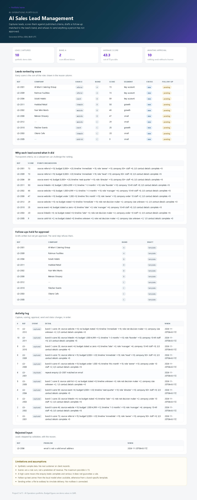

# Project 3 — AI sales lead management

A lead pipeline that captures enquiries, scores them against published
criteria, drafts a follow-up matched to the lead's band, and refuses to send
anything a person has not approved.

Built with **synthetic data**. Not a delivered client system, and the scores
are not predictions of revenue.

## The business problem

Small B2B sellers lose leads for boring reasons:

1. Every enquiry gets the same reply, so a 40-site contract waits behind a
   one-shop price request.
2. The same buyer enquires twice and is worked twice.
3. Nobody can explain why one lead was chased and another was not.

## What this project does

| Step | Behaviour |
|---|---|
| Capture | Reads a JSONL feed of leads |
| Validate | Rejects a bad email or missing name, and records why |
| Deduplicate | Same reference **or same email** returns the existing lead |
| Score | Six named rules, maximum 73 points, breakdown stored with the lead |
| Band | A = 60+, B = 35–59, C = below 35 |
| Segment | Key account, growth or small, from headcount and stated budget |
| Draft | Band-matched follow-up; model text when available, template otherwise |
| Approve | A named person approves; recorded in the activity log |
| Send | Refused unless approved, and refused for a lost lead |
| Pipeline | `new` → `contacted` → `qualified` → `won` / `lost`, with allowed moves only |
| Report | Counts by band, source and status, average score, stated pipeline value |

## The scoring rules

| Rule | Points | Why |
|---|---|---|
| Source: referral / website / linkedin / event / cold-list / other | 15 / 10 / 8 / 6 / 2 / 0 | A referral costs less to close than a cold list |
| Budget 5,000+ / 1,000–4,999 / under 1,000 / none | 20 / 12 / 5 / 0 | Stated budget is the strongest buying signal |
| Timeline immediate / 1–3 months / later / unknown | 15 / 10 / 3 / 3 | Urgency drives follow-up speed |
| Role owner, founder, director, head, CEO / manager / other | 10 / 6 / 2 | Can this person actually decide |
| Company 50+ / 10–49 / under 10 / unknown staff | 8 / 5 / 2 / 2 | Volume potential |
| Contact details complete (email, company, message) | 5 or 0 | Incomplete records waste a call |

Maximum 73. The dashboard shows the arithmetic for every lead, so a
salesperson can disagree with a ranking and see exactly why.

## Run it

```bash
cd PROJECT-03-SALES-AUTOMATION
python run.py demo                    # reset and capture data/leads.jsonl
python run.py list                    # ranked by score
python run.py approve 1 --by "Your Name"
python run.py send 1
python run.py status 1 contacted
python run.py report
python run.py dashboard
```

No packages to install. Python 3.10 or newer.

## Demo result

12 leads in the file:

```
accepted 10 | duplicate 1 | rejected 1
average score 43.3 | band A 2 | stated pipeline value 54,500 QAR
```

The duplicate is the same buyer enquiring again under a new reference. It is
matched on email and attached to the original lead, not created twice. The
rejection is a malformed email address.



## Design decisions

**The score is arithmetic, not a model.** Every point has a rule, and the
reason string is stored on the lead. A sales manager can change a threshold
and see the effect immediately. A model would be harder to defend in a
disagreement about which lead deserved the call.

**Deduplication matches email, not just the source id.** The first version
only matched the reference and let a repeat enquiry through under a new id.
The test `test_duplicate_email_under_new_reference` covers the fix.

**Band drives the wording, not just the priority.** A gets a call request, B
gets a price list plus qualifying questions, C gets a soft keep-in-touch. That
is the difference between a scoring toy and something a salesperson would use.

**Nothing sends itself.** `approved` starts false and `send()` raises without
it. A lost lead cannot be emailed at all.

## Limitations

- Scores are not calibrated against actual conversion. There is no won/lost
  history to fit them to.
- Band boundaries (60 and 35) are judgement calls.
- Budget is taken at face value. Nobody verifies it.
- No email sequencing, no reminders, no calendar booking.
- Sending writes a `.txt` file to `outbox/`. No mailbox is connected.
- Duplicate matching is exact email only. `hassan+1@` and `hassan@` are
  different people to this system.

## Files

| File | Purpose |
|---|---|
| `leads.py` | Scoring, deduplication, drafting, approval, pipeline, reporting |
| `run.py` | Command line interface and dashboard |
| `schema.sql` | SQLite tables |
| `data/leads.jsonl` | 12 synthetic leads covering every band |
| `make-scenario.json` | Make build spec (not an imported blueprint) |
| `make-logic.js` | Reference rules, executed by `tools/check_scenarios.py` |
| `architecture.md` | Flow and data model |
| `test-cases.md` | Test evidence |
